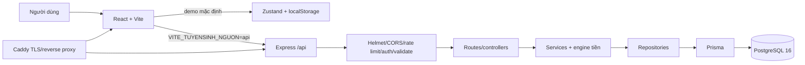
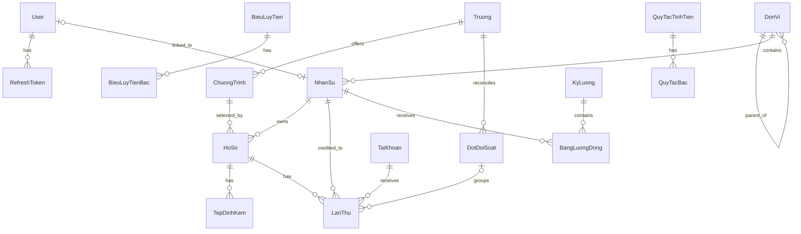

# Hoa Hồng Tuyển Sinh — Project Context

> Nguồn sự thật của tài liệu này là mã nguồn trong workspace, khảo sát ngày 31-10-2026. Không suy diễn nghiệp vụ khi chưa có bằng chứng. Các nội dung chưa hoàn chỉnh được đánh dấu rõ ràng.

## 1. Giới thiệu, mục đích và phạm vi

Hoa Hồng Tuyển Sinh là hệ thống quản lý tuyển sinh liên kết của Trường Trung cấp Quốc tế Phoenix. Hệ thống quản lý danh mục chương trình/trường, mạng lưới nhân sự, hồ sơ học viên, các lần thu học phí, đợt đối soát tiền về, tham số chính sách và kỳ lương/quyền lợi tuyển sinh. Frontend có thể hiển thị thêm mục tư vấn Sale chưa đủ dữ liệu để vận hành; các mục đó không mặc nhiên là chương trình mở tuyển sinh hay được phép thu tiền/tính hoa hồng.

Nguyên tắc nghiệp vụ cốt lõi đã được hiện thực là: doanh số phát sinh khi học viên nộp tiền, nhưng quỹ chi và quyền lợi chỉ phát sinh khi đối tác đã chuyển tiền về. Hoa hồng không tính trực tiếp theo học phí mà đi qua quỹ chi.

Frontend tuyển sinh mặc định dùng `localStorage`; route công khai ở nguồn `demo` và chỉ được bọc `ProtectedRoute` khi chọn nguồn `api`. Backend đã có module tuyển sinh dùng PostgreSQL, nhưng nguồn `api` phía frontend chưa được kiểm thử contract end-to-end và hiện còn lỗi typecheck/test (mục 14, 16). Bootstrap xác thực chỉ gọi `POST /api/auth/refresh` ở nguồn `api`; mở `/tuyensinh` ở nguồn demo không cần backend.

## 2. Công nghệ và cách chạy

| Phần            | Công nghệ đã xác minh                                                                                                                                                |
| --------------- | -------------------------------------------------------------------------------------------------------------------------------------------------------------------- |
| Runtime         | Node.js `>=20` (Docker/CI dùng Node 20)                                                                                                                              |
| Package manager | npm, có `package-lock.json` cho cả backend/frontend                                                                                                                  |
| Frontend        | React 18, Vite 5, TypeScript strict, React Router 6, TanStack Query 5, Axios, Zustand, React Hook Form, Zod, Tailwind/shadcn-ui, Vitest/Testing Library              |
| Backend         | Express 4, TypeScript strict (ESM), Prisma 5, Zod + zod-to-openapi, JWT, bcryptjs, Pino, Helmet, CORS, compression, express-rate-limit, Swagger UI, Vitest/Supertest |
| Database        | PostgreSQL 16; tiền dùng `BIGINT`, tỷ lệ dùng integer ppm (1.000.000 = 100%)                                                                                         |
| Hạ tầng         | Docker Compose, Nginx, Caddy/Let's Encrypt, GitHub Actions, GHCR; pgAdmin, Dozzle/Uptime Kuma tùy chọn                                                               |

Chạy dev đầy đủ: `cp .env.example .env && docker compose up -d` (hoặc `make up`). Frontend: `http://localhost:5173`; API: `http://localhost:3000/api`; Swagger: `/api/docs`. `Dockerfile.dev` tự chạy Prisma generate, migrate deploy, `prisma db seed`, rồi bật backend. Seed chính hiện gọi cả seed admin và seed tuyển sinh.

`thuchien.md` mô tả một phương án dựng lại khác (Node 22.6+, Express 5, `pg`/SQL viết tay, MinIO); đó không phải stack đang chạy trong workspace này.

Các lệnh quan trọng:

| Mục đích                          | Lệnh                                                                                           |
| --------------------------------- | ---------------------------------------------------------------------------------------------- |
| Backend dev/build/test/lint       | `cd backend && npm run dev                                                                     | build | test | lint` |
| Frontend dev/build/test/lint      | `cd frontend && npm run dev                                                                    | build | test | lint` |
| Đồng bộ engine frontend → backend | `cd backend && npm run engine:sync`                                                            |
| Compose                           | `make up`, `make down`, `make logs s=backend`, `make lint`, `make test`                        |
| Prisma                            | `make migrate name=<ten>`, `make seed`, `cd backend && npm run prisma:studio`                  |
| Production                        | `make prod-up`, `make prod-logs`; backup/restore qua `make backup`, `make restore FILE=<file>` |

Không chạy `make restore` hay thao tác production khi khảo sát/phát triển thông thường.

## 3. Kiến trúc tổng thể

Backend dùng cấu trúc module theo lớp `route → controller → service → repository → Prisma`; repository là nơi module được phép gọi Prisma. Frontend tổ chức theo feature, có lớp API và hook nguồn dữ liệu để chuyển giữa demo/API.



Entry point: frontend `frontend/src/main.tsx` → `App.tsx`; backend `backend/src/server.ts` → `createApp()` trong `src/app.ts`. Backend mount mọi API tại `/api` trong `src/routes.ts`.

## 4. Cấu trúc thư mục và module

| Vị trí                                                         | Vai trò                                                                                    |
| -------------------------------------------------------------- | ------------------------------------------------------------------------------------------ |
| `frontend/src/api`                                             | Axios client, auth/users API và lớp API tuyển sinh đang cần đối chiếu                      |
| `frontend/src/features/auth`, `users`                          | Giao diện/hook auth và người dùng                                                          |
| `frontend/src/features/tuyensinh`                              | Chín route màn hình; `engine` tiền; `du-lieu`, `kho` cho demo; `nguon` là adapter demo/API |
| `frontend/src/routes`, `layouts`, `stores`                     | Router, route guard, layout, Zustand auth                                                  |
| `backend/src/config`, `lib`, `middlewares`, `utils`            | Env, JWT/Prisma/logger, bảo mật/validation/lỗi, tiện ích chung                             |
| `backend/src/modules/auth`, `users`, `health`, `tuyensinh`     | Module dọc theo route/controller/service/repository/schema                                 |
| `backend/src/modules/tuyensinh/engine`                         | Bản sao byte-for-byte engine frontend; test đồng bộ chặn lệch                              |
| `backend/prisma`                                               | Prisma schema, migrations SQL, seed admin và seed tuyển sinh                               |
| `caddy`, `scripts`, `docker-compose*.yml`, `.github/workflows` | Reverse proxy, backup/restore/VPS, container, CI/CD                                        |
| `LOGIC.md`, `thuchien.md`                                      | Tài liệu nghiệp vụ/triển khai hiện có; phải đối chiếu với code                             |

### Module backend

- `auth`: đăng ký/đăng nhập, access JWT và refresh token httpOnly xoay vòng; chỉ hash refresh token lưu database.
- `users`: CRUD tài khoản hệ thống; `ADMIN` quản lý, `USER` chỉ xem chính mình.
- `health`: ping PostgreSQL bằng `SELECT 1`.
- `tuyensinh`: danh mục/chính sách, danh bạ trường tham khảo, phạm vi nhân sự, hồ sơ, lần thu, đối soát, tài khoản nhận tiền, tính/chốt kỳ lương.

## 5. Request, lỗi, log, cấu hình và bảo mật

`app.ts` đặt theo thứ tự: request logger → Swagger (nếu bật) → Helmet → CORS có credentials → compression → JSON/urlencoded giới hạn 1 MB → cookie parser → rate limit + `/api` routes → not-found → error handler.

- Response thành công: `{ success: true, data, message?, meta? }`; lỗi: `{ success: false, data: null, message, error: { code, details? } }`.
- Zod lỗi trả 422; AppError trả mã nghiệp vụ; Prisma unique/not-found thành 409/404; lỗi không rõ được Pino log và che chi tiết ở production.
- Pino thêm `X-Request-Id`, redact Authorization/cookie/set-cookie; health không auto-log.
- Rate limit: toàn API 300/15 phút, login/register 20/15 phút; test và health được skip.
- `config/env.ts` Zod bắt buộc `DATABASE_URL`, hai JWT secret ít nhất 32 ký tự, CORS origin; app dừng khi env sai. Không đọc hay ghi giá trị secret thực trong tài liệu này.
- Không thấy cache server-side/Redis. Frontend dùng TanStack Query để cache theo `queryKey`/`staleTime`; nguồn tuyển sinh đặt thời hạn cache khác nhau theo từng query.

Auth: access token trong header Bearer và chỉ trong memory Zustand; refresh token `httpOnly`, `sameSite=strict`, path `/api/auth`, secure khi production. Refresh reuse thu hồi mọi token còn hoạt động của user.

## 6. Vai trò, phạm vi và phân quyền nghiệp vụ

Hai loại vai trò khác nhau: `User.role` (`ADMIN|USER`) phục vụ quyền hệ thống; `NhanSu.vaiTro` (`NV|TN|TP|ADMIN`) phục vụ phạm vi tuyển sinh. Các route tuyển sinh đều cần access token, nhưng không phải mọi service đều kiểm tra tài khoản có gắn `NhanSu`: các endpoint hồ sơ, lần thu, `/toi-la`, `/nhan-su`, `/tong-quan` và các lệnh ghi có kiểm tra bối cảnh/phạm vi; một số endpoint đọc danh mục, chính sách, đối soát, tài khoản và kỳ lương hiện chỉ yêu cầu token. Vì vậy tài khoản chưa gắn nhân sự vẫn có thể đọc dữ liệu qua các route đó; ý định phân quyền này **chưa xác định** và cần được rà soát trước khi mở API cho người dùng thật.

| Vai trò nghiệp vụ | Phạm vi xem                                      |
| ----------------- | ------------------------------------------------ |
| NV                | chính mình                                       |
| TN                | toàn nhân sự trong cùng nhóm                     |
| TP                | nhân sự các nhóm trực thuộc phòng và chính phòng |
| ADMIN             | tất cả nhân sự                                   |

Tạo đợt đối soát: TN/TP/ADMIN theo service, dù tab Đối soát trên frontend hiện chỉ hiển thị cho TP/ADMIN. Xác nhận tiền về, tính/chốt kỳ lương: TP/ADMIN. Khai tài khoản nhận học phí: chỉ ADMIN. Database trigger ép NV/TN thuộc nhóm, TP/ADMIN thuộc phòng; cây đơn vị chỉ Phòng → Nhóm → nhân sự.

## 7. Dữ liệu, quan hệ và ràng buộc database

Database là PostgreSQL qua Prisma. Migration `20261029234538_tuyensinh_domain` bổ sung miền tuyển sinh và SQL CHECK/trigger là lớp bảo vệ quan trọng, không được thay thế bằng kiểm tra client.



Nhóm bảng chính:

- Identity: `users`, `refresh_tokens` (UUID PK; email/token hash unique; token cascade khi xóa user).
- Tổ chức/danh mục: `don_vi`, `nhan_su`, `truong`, `chuong_trinh`, `tai_khoan`.
- Tham khảo: `doi_tac_tham_khao` lưu đầu mối trường, nguồn công khai, hình thức đào tạo được xác nhận, trạng thái khảo sát và lưu trữ. Bảng này độc lập, không FK tới `truong`/`chuong_trinh` và không tham gia dòng tiền hay engine hoa hồng.
- Vận hành: `ho_so`, `tep_dinh_kem`, `lan_thu`, `dot_doi_soat`.
- Chính sách có hiệu lực thời gian: `co_cau_quy_chi`, `dau_viec`, `bieu_luy_tien`/`bieu_luy_tien_bac`, `thuong_nguong`, `quy_tac_tinh_tien`/`quy_tac_bac`, `tham_so_co_che`, `gia_dinh`.
- Chốt lương: `ky_luong`, `bang_luong_dong`.

Các khóa/trường nghiệp vụ chính: `User.id` là UUID, `email` unique; `NhanSu.id` UUID, `ma` unique, `userId` optional/unique FK và `donViId` FK; `DonVi` có self-FK `chaId`. `Truong.ma` và `ChuongTrinh.ma` unique; chương trình tham chiếu trường và giữ `soKy`, `hocPhiKy`, `tyLeTrichPpm`, `thuePpm`, `dinhMucKy`. `HoSo.ma` unique, FK tới chương trình và chủ hồ sơ; `LanThu.ma` unique, FK tới hồ sơ/tài khoản/nhân sự/đợt, unique `(hoSoId, kyThu)`; `DotDoiSoat.ma` unique và thuộc một trường. Bảng policy dùng khóa ghép theo mã/ngày hiệu lực hoặc UUID cùng ngày hiệu lực. `KyLuong.thang` là tháng nghiệp vụ unique; `BangLuongDong` unique theo kỳ + nhân sự và lưu snapshot/số tiền dưới dạng BigInt.

Index/unique quan trọng: mã nghiệp vụ unique; `lan_thu(ho_so_id, ky_thu)` unique; `bang_luong_dong(ky_luong_id, nhan_su_id)` unique; bảng phiên bản dùng key `(ma, hieu_luc_tu)`; indexes cho FK, trạng thái, ngày lập/ngày thu. Xem `schema.prisma` và migration SQL để có danh sách đầy đủ.

Ràng buộc/triggers: quỹ chi chương trình phải dương; tỷ lệ/đầu việc theo từng `hieu_luc_tu` cộng đúng 1.000.000 ppm; kỳ thu không vượt số kỳ và bắt buộc chứng từ; `ky_da_thu`/trạng thái hồ sơ tự đồng bộ; lần thu chỉ `DA_NHAN_TIEN` khi đợt đã nhận tiền; kỳ/bảng lương đã chốt bất biến, kỳ vượt trần không chốt được. Migration hiện **không có** exclusion/range constraint chặn các khoảng hiệu lực chính sách bị chồng lấn; `LOGIC.md` và `thuchien.md` có yêu cầu/đề xuất ràng buộc này nhưng code chưa hiện thực.

Migration/seed: Prisma migration dùng `migrate deploy`. `backend/prisma/seed.ts` hiện gọi `seed-tuyensinh.ts`; workflow deploy chạy `node dist/seed.js` sau migrate và health check. Seed tuyển sinh upsert dữ liệu danh mục/chính sách theo khóa nghiệp vụ và thay thế danh sách bậc của một số chính sách bằng `deleteMany` + `createMany`; do đó không nên coi đây là seed chỉ tạo admin hoặc chạy vô hại trên DB có dữ liệu vận hành. Việc cho phép seed dữ liệu mẫu mỗi lần deploy production cần được quyết định/kiểm soát.

## 8. Luồng nghiệp vụ đã xác minh

```mermaid
sequenceDiagram
  participant CB as Cán bộ/phạm vi được phép
  participant API as API + Service
  participant DB as PostgreSQL
  CB->>API: Tạo hồ sơ
  API->>DB: ho_so, chủ hồ sơ = nhân sự đăng nhập
  CB->>API: Ghi nhận lần thu + chứng từ/tài khoản
  API->>DB: soTien = hocPhiKy, kyThu kế tiếp, CHO_DOI_SOAT
  Note over DB: Trigger cập nhật ky_da_thu/trạng thái hồ sơ
  TN->>API: Lập đợt đối soát
  API->>DB: Gán các lần thu vào đợt CHUA_NHAN_TIEN
  TP->>API: Xác nhận tiền về
  API->>DB: Đợt/lần thu thành DA_NHAN_TIEN
  Note over DB: Đây là mốc quỹ chi/quyền lợi hợp lệ
  TP->>API: Tính rồi chốt kỳ lương
  API->>DB: snapshot tham số, bang_luong_dong; trigger chặn vượt trần/sửa sau chốt
```

Trạng thái:

- Hồ sơ: `CHO_THANH_TOAN` → `DANG_HOC` sau lần thu; → `DA_DU_HOC_PHI` khi đủ số kỳ; `THOI_HOC` không được ghi nhận thêm lần thu. Cách chuyển sang `THOI_HOC` qua API/UI: **chưa xác định** (không có endpoint mutation tương ứng).
- Lần thu: `CHO_DOI_SOAT` → `DA_NHAN_TIEN` chỉ qua đợt đối soát đã nhận tiền.
- Đợt: `CHUA_NHAN_TIEN` → `DA_NHAN_TIEN`.
- Kỳ lương: `MO` → `DA_CHOT`; sau chốt bất biến.

## 9. Quy tắc tiền và công thức được triển khai

Engine chính: `backend/src/modules/tuyensinh/engine/` (đồng bộ từ frontend và kiểm tra từng byte). Tiền ở DB là `BIGINT`; engine dùng number trong giới hạn an toàn và ppm integer; làm tròn nửa lên, xa số 0.

| Quy tắc                 | Mã triển khai                                                                                                     |
| ----------------------- | ----------------------------------------------------------------------------------------------------------------- |
| Tiền trích              | `hocPhiKy × tyLeTrichPpm / 1_000_000`, `nhanTyLe`                                                                 |
| Thuế                    | `tienTrichMotKy × thuePpm`                                                                                        |
| Quỹ chi/kỳ              | `tienTrichMotKy - thueMotKy - dinhMucKy` (`quy-chi.ts`)                                                           |
| Học phí toàn khóa       | `hocPhiKy × soKy`                                                                                                 |
| PV                      | `quyChiMotKy / 800_000`                                                                                           |
| Doanh số quy đổi/kỳ     | làm tròn `(quyChiMotKy × 56) / 10`                                                                                |
| Phân bổ cơ cấu/đầu việc | `phanBo` theo phương pháp phần dư lớn nhất, bảo toàn tổng đúng từng đồng                                          |
| Quy tắc trả             | chọn phạm vi cụ thể nhất ngành > trường > hệ > mặc định, rồi tính tỷ lệ/số tiền/bậc; áp trần ppm nếu có           |
| Lương mềm               | lũy tiến biên trên doanh số quy đổi, làm tròn một lần cuối                                                        |
| Thưởng ngưỡng           | số tiền phẳng của ngưỡng cao nhất đạt được                                                                        |
| Ứng trước/công nợ       | quyền lợi ≥ sàn: thu nợ phần vượt sàn; quyền lợi < sàn và đạt chỉ tiêu: ứng đến sàn; không đạt: chỉ chi quyền lợi |

Kỳ lương lấy doanh số/lần thu theo `ngay_thu`, quyền lợi theo `dot_doi_soat.ngay_nhan_tien`; snapshot các bảng cơ cấu/quy tắc/bậc/thưởng/tham số cơ chế hiệu lực tại ngày cuối tháng. Snapshot không bao gồm toàn bộ đầu vào: thông tin chương trình và phân công nhân sự/đơn vị được đọc từ dữ liệu hiện tại, nên thay đổi các dữ liệu đó có thể làm kết quả tính lại khác. Lương mềm và thưởng ngưỡng hiện chỉ được lưu/hiển thị, **không cộng vào thực nhận**; service trả warning nêu rõ chính sách này chưa chốt.

`chiaDauViec` và trọng số 11 đầu việc tồn tại, nhưng chưa có dữ liệu phân công/nghiệm thu theo hồ sơ và tính lương chưa gọi phép chia này. Vai trò CTV có thể xuất hiện trong quy tắc tính và engine, nhưng chưa thuộc enum nhân sự nghiệp vụ và chưa được đưa vào vòng tính kỳ lương.

## 10. API đã có trong backend

Tất cả endpoint dưới `/api`; ngoài health và một số route auth, API bị rate limit. Route tuyển sinh đều cần Bearer access token; các quyền/phạm vi trong bảng dưới là theo code hiện tại.

| Method + endpoint                                           | Quyền hiện tại                                   | Input chính                                                             | Kết quả/chức năng                                                                          |
| ----------------------------------------------------------- | ------------------------------------------------ | ----------------------------------------------------------------------- | ------------------------------------------------------------------------------------------ |
| `GET /health`                                               | Public                                           | —                                                                       | Trạng thái app/DB, uptime, timestamp                                                       |
| `POST /auth/register`, `/auth/login`                        | Public; auth rate limit                          | `email`, `password`, `name` (register) hoặc `email`, `password` (login) | `user`, access token; refresh cookie                                                       |
| `POST /auth/refresh`, `/auth/logout`                        | Refresh cookie                                   | Cookie `refresh_token`                                                  | Xoay token hoặc thu hồi phiên                                                              |
| `GET /auth/me`                                              | Access token                                     | —                                                                       | User hiện tại                                                                              |
| `GET /users`                                                | System `ADMIN`                                   | `page`, `limit`, `search`, `role`, `sortBy`, `sortOrder`                | Danh sách user + phân trang                                                                |
| `POST /users`                                               | System `ADMIN`                                   | `email`, `password`, `name`, `role?`                                    | User mới                                                                                   |
| `GET /users/:id`                                            | System `ADMIN` hoặc chủ sở hữu                   | UUID `id`                                                               | User, không trả password                                                                   |
| `PATCH /users/:id`, `DELETE /users/:id`                     | System `ADMIN`; không tự xóa tài khoản           | Trường user tùy chọn / UUID `id`                                        | User đã sửa / xác nhận xóa                                                                 |
| `GET /tuyensinh/toi-la`, `/nhan-su`, `/tong-quan`           | Đã gắn `NhanSu`; phạm vi theo vai trò            | Tổng quan nhận tháng hiện tại                                           | Bối cảnh người gọi, danh sách nhân sự trong phạm vi hoặc số liệu tháng                     |
| `GET /tuyensinh/danh-muc`                                   | Chỉ access token hiện tại; chưa kiểm tra phạm vi | —                                                                       | Danh mục chương trình vận hành và số tiền dẫn xuất; không gồm mục tư vấn chỉ có ở frontend |
| `GET /tuyensinh/tham-so`                                    | Chỉ access token hiện tại; chưa kiểm tra phạm vi | `ngay?` (`YYYY-MM-DD`)                                                  | Tham số hiệu lực, bảng giả định                                                            |
| `GET /tuyensinh/co-cau`, `/tran-chi`                        | Chỉ access token hiện tại; chưa kiểm tra phạm vi | `chuongTrinhMa`, `ngay?`, `bac?`                                        | Phân bổ quỹ chi/đầu việc hoặc kết quả soát trần                                            |
| `GET /tuyensinh/ho-so`                                      | Đã gắn nhân sự; lọc theo phạm vi                 | `page`, `limit`, `search`, `trangThai`, `chuongTrinhMa`, `nhanSuMa?`    | Danh sách hồ sơ + phân trang                                                               |
| `POST /tuyensinh/ho-so`                                     | Đã gắn nhân sự                                   | chương trình, thông tin thí sinh, metadata `tep?`                       | Tạo hồ sơ; chủ sở hữu do server gán                                                        |
| `POST /tuyensinh/ho-so/:id/lan-thu`                         | Đã gắn nhân sự, hồ sơ trong phạm vi              | `soChungTu`, `taiKhoanId`, `bienLaiTen?`, `ngayThu?`                    | Ghi lần thu kế tiếp; server suy ra số tiền/kỳ                                              |
| `GET /tuyensinh/lan-thu`                                    | Đã gắn nhân sự; lọc theo phạm vi                 | `trangThai?`, `truongMa?`, `chuaCoDot?`, `limit?`                       | Danh sách lần thu                                                                          |
| `GET /tuyensinh/dot-doi-soat`                               | Chỉ access token hiện tại; chưa kiểm tra phạm vi | —                                                                       | Danh sách đợt đối soát                                                                     |
| `POST /tuyensinh/dot-doi-soat`                              | TN/TP/ADMIN nghiệp vụ                            | `truongMa`, `lanThuIds[]`, `ghiChu?`                                    | Tạo đợt chưa nhận tiền                                                                     |
| `POST /tuyensinh/dot-doi-soat/:id/nhan-tien`                | TP/ADMIN nghiệp vụ                               | `ngayNhanTien?`                                                         | Đánh dấu đã nhận; trigger cập nhật các lần thu                                             |
| `GET /tuyensinh/tai-khoan`                                  | Chỉ access token hiện tại; chưa kiểm tra phạm vi | —                                                                       | Tài khoản nhận tiền, gồm số tài khoản                                                      |
| `POST /tuyensinh/tai-khoan`                                 | ADMIN nghiệp vụ                                  | chủ tài khoản, ngân hàng, BIN, số tài khoản                             | Tạo tài khoản nhận tiền                                                                    |
| `GET /tuyensinh/ky-luong`, `/tuyensinh/ky-luong/:thang`     | Chỉ access token hiện tại; chưa kiểm tra phạm vi | `thang` dạng `YYYY-MM` với route chi tiết                               | Danh sách hoặc chi tiết bảng lương                                                         |
| `POST /tuyensinh/ky-luong/:thang/tinh`, `/chot`             | TP/ADMIN nghiệp vụ                               | `thang` dạng `YYYY-MM`                                                  | Tính lại hoặc chốt kỳ; chặn chốt khi vượt trần                                             |
| `GET /tuyensinh/doi-tac-tham-khao`, `/:ma`                  | Public                                           | `search?`, `vung?`, `hinhThuc?`, `trangThaiHopTac?`                     | Danh bạ tham khảo đang hoạt động/công khai; tách khỏi danh mục vận hành                    |
| `GET /tuyensinh/doi-tac-tham-khao/admin`                    | System `ADMIN`                                   | `search?`, `vung?`, `hinhThuc?`, `trangThaiHopTac?`, `includeArchived?` | Danh sách quản trị, có thể gồm bản ghi đã lưu trữ                                          |
| `POST`, `PATCH /tuyensinh/doi-tac-tham-khao[/id]`           | System `ADMIN`                                   | Trường danh bạ đã kiểm bằng Zod                                         | Thêm/sửa đầu mối; không tạo `Truong` hay `ChuongTrinh` vận hành                            |
| `DELETE`, `POST /tuyensinh/doi-tac-tham-khao/:id/khoi-phuc` | System `ADMIN`                                   | UUID `id`                                                               | Lưu trữ mềm/khôi phục; không xóa cứng lịch sử                                              |

Request tuyển sinh được kiểm bằng Zod trong `tuyensinh.schema.ts`; success/error dùng envelope ở mục 5. OpenAPI hiện chỉ đăng ký health/auth/users, chưa có route tuyển sinh.

Danh bạ trường tham khảo là ngoại lệ public dưới `/api/tuyensinh`: GET không cần đăng nhập; mọi thao tác quản trị kiểm tra vai trò hệ thống `User.role=ADMIN`, không dùng `NhanSu.vaiTro`. Khi thêm/sửa, API bắt buộc `tinhThanh` là chuỗi không rỗng; bản ghi cũ có `tinhThanh = NULL` được DTO trả về `"Chưa xác định"` để giữ contract frontend không-null.

## 11. Frontend và trạng thái tích hợp

Routes `/login`, `/register`, `/tong-quan`, `/users` dùng auth/API. Nhánh `/tuyensinh` chỉ công khai ở nguồn demo; nguồn api được bọc `ProtectedRoute` và ẩn bộ chọn demo. `App` chỉ thử `POST /api/auth/refresh` lúc khởi động khi nguồn tuyển sinh là `api`; ở demo, auth chuyển sang chưa đăng nhập mà không gọi backend.

Nguồn API chỉ thay một phần dữ liệu: hồ sơ/lần thu/đợt/tài khoản/kỳ lương có query backend, trong khi cơ cấu quỹ chi và tham số cơ chế vẫn lấy từ Zustand/localStorage (máy chủ mới có endpoint ĐỌC `/tham-so`, chưa có endpoint ghi). Các hook tổng hợp, sổ công nợ, bảng lương và soát trần vẫn rơi về phép tính cục bộ khi API đang tải hoặc lỗi; do đó nguyên tắc “API mode chỉ hiển thị số máy chủ” vẫn chưa đúng tuyệt đối với code hiện tại. Không dùng nguồn API để vận hành thật trước khi xử lý các lệch ở mục 16.

Ngày 31-10-2026 đã chạy đối chiếu nguồn `api` với backend đang bật (Postgres 5434, API 3000), đăng nhập `tp01@phoenix.local`, đi hết bảy màn hình và lập một hồ sơ mới kèm thu kỳ 1 qua giao diện. Số hiển thị khớp API từng đồng (doanh số quy đổi 47.040.000đ, lương mềm 857.440đ, thưởng 300.000đ, quyền lợi NV01 4.500.000đ, thực nhận 5.000.000đ, nợ 500.000đ, thù lao TN 806.400đ và TP 873.600đ); hồ sơ mới sinh `HS2600004`/`LT26000004` ở trạng thái `CHO_DOI_SOAT` với quỹ chi chờ đối soát 1.250.000đ và quyền lợi 750.000đ. Bốn độ lệch đã sửa trong lần chạy này: ghi nhận thu gửi mã hồ sơ thay vì uuid (422), lọc trùng phạm vi làm trưởng phòng thấy bảng rỗng, `/tong-quan` không trả quyền lợi theo người nên lấy từ dòng bảng lương, và danh sách kỳ lương chỉ đọc kho demo nên luôn hiện “Chưa mở”.

Dữ liệu Sale trên lưới gồm chương trình vận hành, sản phẩm tư vấn Phoenix và
chương trình tư vấn của trường khác. Hai loại tư vấn là dữ liệu frontend riêng:
không thuộc model `ChuongTrinh`, không được trả bởi `GET /tuyensinh/danh-muc`,
không đi vào tạo hồ sơ, thu học phí hay engine quyền lợi. Model vận hành vẫn
yêu cầu số kỳ, học phí mỗi kỳ, tỷ lệ trích, thuế và định mức; không nới lỏng
các trường này để chứa mục chưa có dữ liệu tiền đã xác nhận. Mức “tối đa đến
70%” của Phoenix chỉ là nhãn văn bản, không lưu ppm hoặc tính ra số tiền vì
chưa chốt cơ sở, đối tượng nhận và thời điểm đối soát.
Chương trình vận hành chưa có `daDoiChieu=true` được gắn cảnh báo và không hiện
khoản Sale dự kiến; nút lập hồ sơ hiện chưa bị chặn. Đây không phải trạng thái
xác nhận chương trình đang mở tuyển sinh.

Danh mục frontend gồm tên khóa ngắn hạn có nguồn Phoenix 2026, các khóa sơ cấp
có trang chương trình/bài khóa riêng năm 2026, và mục chỉ thấy trong thông báo
năm 2025 được giữ nhãn tham khảo. Trang tổng hợp 2026 nêu 19 khóa ngắn hạn và
26 mô-đun sơ cấp, nhưng trang chương trình và bài khóa học không liệt kê trùng
khớp; không tự tạo tên để bù phần chưa công bố. Trang tổng hợp ghi 2.000.000đ
/module ngắn hạn, 3.500.000đ/sơ cấp và lịch chung thứ 3/thứ 5 hằng tuần; một số
bài ngắn hạn riêng nêu 2.500.000đ. Điều kiện công khai 2026 nêu từ đủ 15 tuổi
và có nhu cầu, không nêu bằng cấp đầu vào; checklist sơ cấp có học bạ và cần
được xác nhận theo khóa. Trước khi vận hành/nhận tiền, xác nhận lại giá, lịch
nhận học viên và chính sách Sale theo từng khóa.

Tại ngày rà soát 31-10-2026, danh mục tư vấn đối tác có 63 ngành thuộc 10
trường, dựa trên thông báo tuyển sinh năm 2026 và kèm đường dẫn nguồn ở từng
chi tiết. Hạn nhận hồ sơ được so với ngày Việt Nam khi mở giao diện; đợt đã
đóng vẫn hiện để Sale biết không nhận hồ sơ mới. Bộ lọc “Văn bằng 2” gồm cả
chương trình được trường gọi chính thức là VB2 và chương trình có thông báo
cho phép người đã có bằng đại học dự tuyển; không suy ra được miễn môn hay
được rút ngắn thời gian. Các trường chưa có thông báo phù hợp không được tạo
thành chip chương trình. Ví dụ, chương trình thứ hai TMU năm 2026 được giới
hạn cho sinh viên đang học tại TMU nên chưa đưa vào danh mục tư vấn người ngoài.
Không có chương trình tư vấn đối tác nào được gán hoa hồng hoặc dùng để thu
tiền trước khi Phoenix xác nhận thỏa thuận.

Danh bạ đầu mối trường tiềm năng là tập dữ liệu riêng, có nguồn công khai và
ghi chú mức độ xác minh. Có dấu hiệu tuyển sinh, đào tạo từ xa/VLVH/VB2/chứng
chỉ không chứng minh trường đang tìm Phoenix làm đối tác, cũng không chứng minh
đã ký hợp tác. Bản ghi không trở thành chương trình Sale được phép tư vấn thu
tiền; không lưu học phí/hoa hồng, không nối vào `Truong`/`ChuongTrinh` và không
đi vào engine. Admin quản lý danh bạ trong `/tuyensinh/quan-tri`; xóa là lưu
trữ mềm, có thể khôi phục.

Danh bạ tham khảo hiện có 148 mã; đợt này bổ sung 20 đầu mối và cập nhật thông
báo mới hơn của Học viện Tài chính. Đợt trước bổ sung 20 đầu mối và cập nhật
nguồn riêng cho một số trường thành viên. Dữ liệu có tín hiệu chính thức
về tuyển sinh/hình thức đào tạo linh hoạt, roster trường thành viên hoặc hoạt
động có thể dùng để khảo sát đầu mối. Đây chưa phải danh sách đã rà hết mọi
trường đại học trên toàn quốc, không chứng minh trường đang tìm Phoenix và
không xác nhận đã ký hợp tác. Trong số các trường thành viên vùng, 24 mã hiện
chỉ có nguồn roster; `hinhThuc` để trống cho đến khi có nguồn chương trình riêng.

20 mã mới gồm HNMU, THANHDONG, BAFU, VNUF, VHB, TUETECH, UNETI, UTT, QUI,
DAINAM, HUBT, UFM, TDU, NDUN, AJC, HAU, MIT, BDU, UPT và TNU-FL. Một số nguồn
2026 đã hết cohort hoặc chưa nêu hạn rõ; HNMU/UTT có lịch nhận hồ sơ công khai
nhưng vẫn cần xác nhận ngành, chỉ tiêu và khả năng tiếp nhận trước khi Sale tư
vấn. TNU-FL có nguồn riêng xác nhận từ xa/VB2; không suy rộng thông tin đó cho
các đơn vị thành viên khác. Các nguồn 2024/2025 được đánh dấu lịch sử, không
phải cohort đang tuyển. Hình thức được gán theo phạm vi nguồn cụ thể; không suy
diễn VB2 từ một chương trình liên thông cùng trình độ. Đại học Trà Vinh đổi tên
theo Quyết định 73/QĐ-TTg ngày 12/01/2026.

20 đầu mối bổ sung đợt này gồm VUI, TLU, HUNRE, HANU, SKDA, HICT, SDU, HPMU,
NAU, TBUMP, LTVU, UTH, HSU, HIU, GDU, HUST, EPU, VMU, VUTED và UTEHY. Các
thông báo có cohort đã kết thúc, lịch/chỉ tiêu chưa rõ hoặc điều kiện riêng
theo ngành sức khỏe; Hoa Sen có hạn nhận hồ sơ đợt 3 được nêu là 28/12/2026.
Mọi mã mới đều ở trạng thái `TIEM_NANG`; nguồn tuyển sinh không chứng minh
Phoenix được trường chọn làm đối tác.

## 12. Vận hành, triển khai và tích hợp ngoài

- Caddy: TLS Let's Encrypt, security headers, reverse proxy `/api/*` sang backend và phần còn lại sang Nginx frontend.
- PostgreSQL/pgAdmin: DB; pgAdmin chỉ dev profile.
- GitHub Actions: PR chạy lint/test/build/Docker build; push `main` gọi CI, build/push GHCR rồi SCP/SSH VPS, migrate, health check, chạy `node dist/seed.js` (seed admin và seed tuyển sinh).
- Danh bạ tham khảo có migration `20261031100000_doi_tac_tham_khao`; nạp dữ liệu ban đầu bằng `cd backend && npm run seed:reference`. Seed hiện có 148 mã và dùng `createMany(skipDuplicates)`, nên chỉ thêm mã mới, không ghi đè chỉnh sửa admin hoặc cập nhật bản ghi trùng mã. Các thay đổi tên/nguồn/hình thức của TVU, HCM-UTE, TDMU, USSH, ULIS, HCMUS và HVTC phải được cập nhật qua màn Quản trị nếu các mã đó đã tồn tại trong DB; chạy lại seed không cập nhật chúng. Seed tham khảo không thuộc seed vận hành/deploy. Migration/seed chưa được chạy trên database trong lần bổ sung này.
- Frontend build tĩnh qua Nginx. `VITE_TUYENSINH_NGUON` mặc định là `demo`, nhưng Dockerfile/CI/deploy hiện chỉ truyền `VITE_API_URL`, không truyền biến chọn nguồn; đường deploy hiện tại vì vậy đóng gói nguồn demo.
- Backup: `db-backup` cron 02:00 theo `TZ`, giữ theo `BACKUP_RETENTION`, có thể gửi remote rclone. Remote/S3/R2 cụ thể: **chưa cấu hình xác minh**.
- Không thấy background job tuyển sinh/cron xử lý nghiệp vụ trong backend; cron đã xác minh là job backup database trong Docker Compose production.
- Không thấy tích hợp API bên thứ ba ở mã runtime tuyển sinh. VietQR được sinh cục bộ theo EMVCo/NAPAS; không gọi dịch vụ VietQR bên ngoài.

## 13. Quy ước lập trình cần giữ

- TypeScript strict; `noUncheckedIndexedAccess`, không unused, import type nhất quán; ESLint + Prettier.
- Backend: controller mỏng, service nghiệp vụ, repository là nơi duy nhất gọi Prisma; Zod validate ở route; `AppError` cho lỗi nghiệp vụ.
- Không gửi/nhận tiền do client quyết định: server suy ra kỳ/số tiền/quy tắc.
- Không dùng float cho tiền/tỷ lệ; ppm và hàm engine hiện có.
- Chính sách có version hiệu lực thời gian; không sửa/xóa lịch sử để “đổi chính sách”.
- Không đổi các trigger/check constraint mà không đánh giá nghiệp vụ/migration/test.

## 14. Kiểm thử hiện có

- Backend: `tests/auth.test.ts` mock repository, không dùng DB thật; `tests/engine-dong-bo.test.ts` so source engine frontend/backend. Chưa thấy test HTTP/service tích hợp tuyển sinh với PostgreSQL.
- Frontend: test engine tiền, lũy tiến, quỹ chi, quy tắc, trần chi, ứng trước, VietQR, adapter API, `Pagination`, luồng danh mục → chi tiết và danh bạ trường (mã, nguồn, độ rộng bằng chứng, lọc, lưu trữ/khôi phục). Đợt mở rộng danh bạ lên 148 mã cần chạy lại typecheck/lint/build/test; kết quả được ghi nhận sau khi hoàn tất lượt kiểm tra này.
- CI chạy lint, test, build cho hai app và Docker build thử.
- Backend tại lần khảo sát: `npm run typecheck` đạt; `npm test -- --reporter=dot` đạt 18/18. Test tuyển sinh hiện chủ yếu là kiểm engine đồng bộ; chưa thấy test HTTP/service tích hợp với PostgreSQL.

## 15. Khu vực cần đặc biệt cẩn trọng

1. `backend/prisma/migrations/20261029234538_tuyensinh_domain/migration.sql`: nghiệp vụ bị khóa ở trigger/CHECK; migration không phải chỉ Prisma schema. Migration chưa có exclusion constraint chống chồng lấn các khoảng hiệu lực.
2. `engine/` tồn tại hai bản nhưng phải byte-identical; dùng `npm run engine:sync` và test đồng bộ nếu thay engine.
3. Dòng tiền có hai mốc thời gian; không trả quyền lợi theo `ngay_thu`.
4. Cây tổ chức đúng ba cấp và quyền TN/TP dựa trên đơn vị cha; không biến thành cây hoa hồng nhiều tầng.
5. Kỳ đã chốt bất biến; sai sót cần bút toán kỳ sau, hiện chưa thấy module bút toán điều chỉnh.
6. Frontend demo/API không cùng độ hoàn thiện; không bật API cho vận hành thật trước khi typecheck, contract test và fallback cục bộ được xử lý.
7. Workspace đang có thay đổi chưa commit ở module tuyển sinh/schema/migration/frontend; khi thay đổi tiếp phải phân biệt với công việc hiện hữu.

## 16. Vấn đề kỹ thuật/độ lệch phát hiện được (không tự sửa trong khảo sát)

1. Ở lần khảo sát 30-10-2026, frontend còn lỗi API export/type và 4 fixture adapter. Tại lần kiểm tra 31-10-2026, các lỗi đó không còn tái hiện: typecheck đạt và frontend test đạt 97/97. Lưu ý đây là kết quả trên working tree đang có thay đổi chưa commit.
2. Một số API đọc nhạy cảm (`/danh-muc`, `/tham-so`, `/co-cau`, `/tran-chi`, `/dot-doi-soat`, `/tai-khoan`, `/ky-luong`) chỉ cần access token, không kiểm tra `NhanSu`/phạm vi; có thể trả cả số tài khoản và dữ liệu bảng lương. Đây là rủi ro phân quyền cần quyết định trước khi mở API, không phải hành vi đã xác nhận là chủ ý.
3. `taoDot` kiểm tra vai trò và trường tồn tại nhưng chưa xác minh toàn bộ `lanThuIds` cùng trường, trạng thái chờ đối soát, chưa thuộc đợt khác hoặc thuộc phạm vi người lập; repository dùng `updateMany`, chưa kiểm số bản ghi cập nhật. Có thể tạo đợt không trọn vẹn hoặc gắn sai lần thu.
4. Seed tuyển sinh đang được gọi từ seed chính và workflow production chạy seed mỗi deploy. Seed upsert danh mục/chính sách và xóa-nạp lại các bậc của một số quy tắc; có in thông tin mật khẩu tài khoản mẫu ra log. Không vận hành seed này như một thao tác chỉ tạo admin; cần chốt cách tách dữ liệu demo và production. Giá trị mật khẩu không được chép vào tài liệu.
5. `LOGIC.md` yêu cầu cấm chồng lấn khoảng hiệu lực bằng PostgreSQL `EXCLUDE`, nhưng migration hiện không có `btree_gist`, `daterange` hay `EXCLUDE`. Các `CHECK` hiện có bảo đảm khoảng từng dòng hợp lệ, không bảo đảm các khoảng giữa nhiều dòng không chồng lấn.
6. Service tính lương chụp `coCau` vào snapshot nhưng không dùng cơ cấu đó để tính tổng chi; `tongChi` cộng `thuLaoTn`/`thuLaoTp` thêm lần nữa trong khi các khoản này đã được cộng vào `quyenLoi`. Với seed hiện tại tổng 20% này trùng tỷ trọng các khoản hóa đơn, nhưng code không tính các khoản hóa đơn độc lập và phụ thuộc vào sự trùng khớp cấu hình.
7. Snapshot kỳ lương không đóng băng chương trình và phân công nhân sự/đơn vị; dữ liệu hiện tại của các bảng này được dùng khi tính lại kỳ cũ. Chưa có bảng phân công/nghiệm thu 11 đầu việc, và vòng tính lương chưa phân bổ theo các đầu việc.
8. Frontend API chưa hoàn chỉnh: upload `/ho-so/:id/tep` chưa có route backend (frontend đã bỏ lệnh gọi, chỉ gửi siêu dữ liệu tên tệp); cơ cấu quỹ chi và tham số cơ chế vẫn ghi vào localStorage vì chưa có endpoint ghi; các hook tiền vẫn tự tính cục bộ khi API đang tải/lỗi; `GET /ho-so` chưa trả mảng `tep`; `/tong-quan` chưa nhận tham số tháng/nhân sự và chưa trả tiền chờ đối soát; `/ky-luong` (danh sách) không kèm `bang`/`snapshot`; `/tuyensinh` ở production image hiện mặc định là demo vì build không truyền `VITE_TUYENSINH_NGUON`. Luồng đọc và ghi chính đã chạy thật ngày 31-10-2026 (mục 11), nhưng vì các điểm trên, API mode vẫn chưa sẵn sàng cho production.
9. Các endpoint tuyển sinh chưa đăng ký trong OpenAPI; test backend auth mock repository, chưa có test API/DB tích hợp; cleanup refresh token hết hạn có hàm nhưng chưa thấy caller/job.
10. Sinh mã hồ sơ/lần thu/đợt bằng `count + 1` có nguy cơ collision khi request đồng thời (unique DB sẽ báo lỗi, không tự retry).
11. `LOGIC.md` tham chiếu `cli.py` và test Python để xác minh số liệu nhưng các tệp đó không có trong workspace, nên không thể chạy/đối chiếu những lệnh này trong lần khảo sát.
12. Tài liệu đầu vào không đồng nhất: `thuchien.md` là hướng dẫn dựng lại với stack/API khác; README feature có nội dung API/upload và tuyên bố API mode không khớp code. Đã cập nhật README feature và phần liên quan trong README gốc; nội dung chính sách chưa chốt trong `LOGIC.md` vẫn được giữ nguyên.

## 17. Nội dung chưa xác định cần làm rõ

- Quy trình/endpoint quản trị danh mục, chính sách, nhân sự tổ chức và thay trạng thái thôi học; code hiện chủ yếu chỉ đọc các tham số đó.
- Quy tắc phân công/ghi nhận nghiệm thu 11 đầu việc cho từng hồ sơ: schema hiện không có bảng phân công/nghiệm thu tương ứng.
- Bút toán điều chỉnh cho kỳ lương đã chốt.
- Chính sách chính thức cho lương mềm/thưởng ngưỡng và các mâu thuẫn nêu ở mục 16.
- Dữ liệu tuyển sinh Phoenix hiện chưa đồng nhất giữa trang tổng hợp, danh sách chương trình và một số trang khóa học riêng; cần xác minh số khóa, học phí, điều kiện, hồ sơ và đợt khai giảng trước khi chuyển mục tư vấn thành chương trình vận hành.
- Mức chia hoa hồng “lên tới 70%” chưa được diễn giải thành quy tắc tính: chưa rõ cơ sở tính, là phần Sale hay tổng quỹ phân phối, và thời điểm ghi nhận/đối soát. Không thay đổi engine hoặc quy tắc tiền trước khi chốt. Trong cấu hình mẫu `NH-CSSD-PTTM`, học phí 2.000.000đ và quỹ chi 800.000đ; 70% học phí gộp sẽ là 1.400.000đ, cao hơn quỹ chi mẫu, nếu hiểu tỷ lệ theo cách đó.
- Có chủ ý cho phép API đọc danh mục, tài khoản nhận tiền và toàn bộ kỳ lương chỉ bằng access token hay không; cần chốt scope/role mong muốn.
- Chính sách an toàn để tách seed dữ liệu tuyển sinh mẫu khỏi deploy production.
- Contract API frontend mục tiêu, cách xử lý khi API lỗi thay vì fallback sang tính toán cục bộ, và kế hoạch chuyển `/tuyensinh` khỏi demo.
- Cơ chế chống chồng lấn khoảng hiệu lực chính sách và phạm vi snapshot cần thiết để tính lại kỳ lương bất biến.

## 18. Tài liệu cần đọc trước khi thay đổi

1. `AGENTS.md` (quy tắc bắt buộc).
2. Tài liệu này.
3. `LOGIC.md` cho nghiệp vụ (đối chiếu code khi có khác biệt); `thuchien.md` là tài liệu phương án dựng lại, không phải mô tả kiến trúc hiện tại; `frontend/src/features/tuyensinh/README.md` cho giới hạn demo/API.
4. Code, schema, migration và test của module bị tác động.
